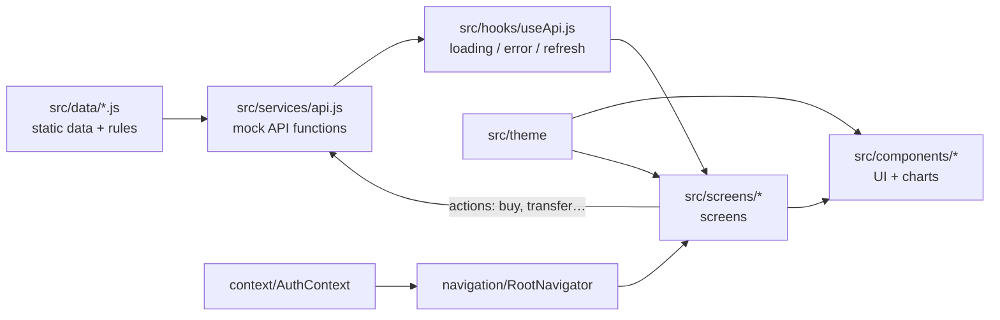
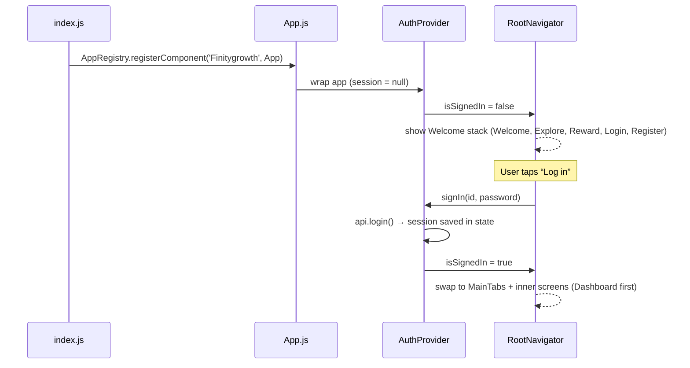
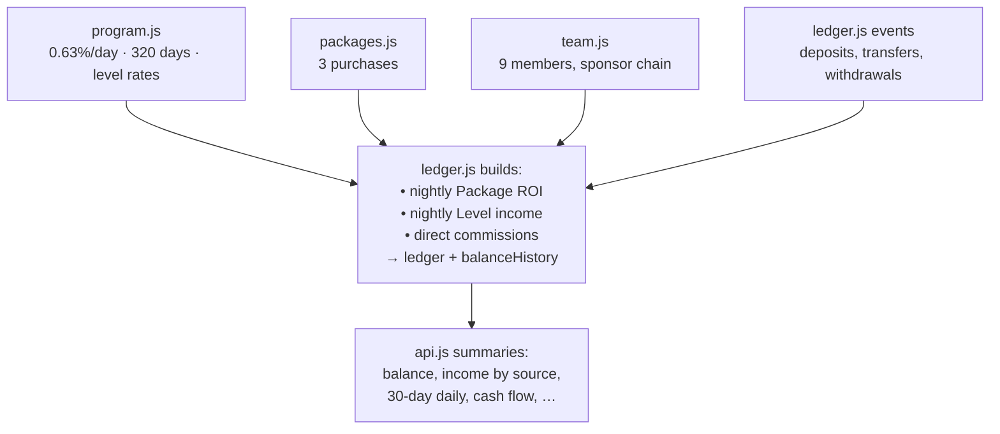

# Architecture – how things are connected

The app is intentionally simple: **one direction of data flow** and **one place for each concern**.



## 1. Layers

| Layer | Folder | Responsibility | Talks to |
|---|---|---|---|
| **Data** | `src/data/` | Static facts: program rules, user, purchases, team, hand-written wallet events. Also builds the full ledger from those facts. | nothing (pure JS) |
| **Service (API)** | `src/services/api.js` | Async functions that return exactly what a screen needs (totals, lists, chart points). Validates actions. | `src/data` |
| **Hook** | `src/hooks/useApi.js` | Calls an API function, tracks `loading` / `error`, exposes `refresh()` for pull-to-refresh. | `api` |
| **State** | `src/context/AuthContext.js` | Who is signed in. Only global state in the app. | `api.login/register` |
| **Navigation** | `src/navigation/` | Which screens exist and how they’re grouped (stack + tabs). | `AuthContext`, screens |
| **Screens** | `src/screens/` | Layout + user interaction for one page. | `useApi`, `api`, components |
| **Components** | `src/components/` | Reusable UI and charts. No data fetching inside. | `theme` |
| **Theme** | `src/theme/index.js` | Colors, fonts, spacing, radius, text presets. | — |

**Rule of thumb:** screens never import from `src/data` directly – always through `api`.
That is what makes swapping in a real backend a one-file job (see DATA-LAYER.md).

## 2. What happens when the app starts



`signOut()` (Profile → Log out) sets the session back to `null` and the navigator swaps back to Welcome.

## 3. How a screen gets its data (example: Wallet)

```js
// src/screens/wallet/WalletScreen.js
const wallet = useApi(api.getWallet);                         // runs on mount
const statement = useApi(() => api.getStatement(filter), [filter]); // re-runs when filter changes

if (!wallet.data) return <Loading />;
<BalanceCard balance={wallet.data.balance} … />
<Screen onRefresh={() => { wallet.refresh(); statement.refresh(); }}>
```

1. `useApi` calls `api.getWallet()`.
2. `api.getWallet()` reads `balanceHistory` + `ledger` from `src/data/ledger.js`, computes totals, waits ~350 ms
   (fake network) and returns an object.
3. The hook stores it in `data`; the screen re-renders with real numbers.
4. Pulling down calls `refresh()` → steps 1–3 again.

## 4. How the static numbers stay consistent

All money values are **derived from the same facts**, so the dashboard, wallet, earnings and charts always agree:



Change a rule (e.g. the daily rate) or add a purchase, and every screen updates automatically.

## 5. Styling

- Every color/font/spacing comes from `src/theme/index.js`. Change the gold there and the whole app follows.
- Fonts are real files in `assets/fonts`, linked into Android/iOS with `npx react-native-asset`.
  The file name = PostScript name (e.g. `Inter-SemiBold.ttf`) so `fontFamily: 'Inter-SemiBold'` works on both platforms.
- Layout uses `StyleSheet.create` + flexbox. No styling library.

## 6. Native setup already done

| Item | Where |
|---|---|
| Fonts linked | `android/app/src/main/assets/fonts/`, `ios/Finitygrowth/Info.plist` (UIAppFonts) |
| react-native-screens Android fix | `MainActivity.kt → onCreate(null)` |
| Autolinked native modules | screens, safe-area-context, svg, linear-gradient (no manual steps) |

## 7. Testing

`npm test` runs:
- `__tests__/App.test.js` – checks the data layer (totals add up, 5% withdrawal fee, validation).
- `__tests__/screens.test.js` – renders all 19 screens with the static data and checks they finish loading.
