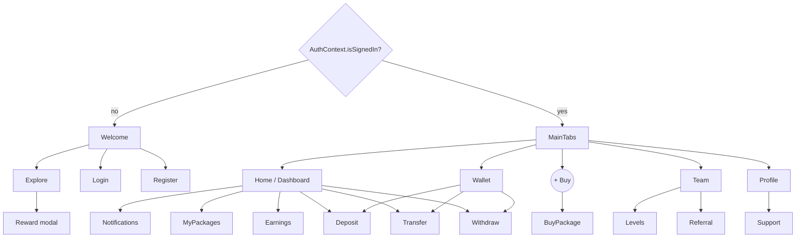

# Navigation

Built with React Navigation 7. Everything is defined in `src/navigation/RootNavigator.js`;
route names are constants in `src/navigation/routes.js`.



## How it is put together

- **RootStack** (`createNativeStackNavigator`) – headers hidden; each screen draws its own `Header`.
  - When signed **out** it contains: Welcome, Explore, Reward, Login, Register.
  - When signed **in** it contains: `MainTabs` + all inner screens (pushed on top of the tabs, so the tab bar hides).
- **MainTabs** (`createBottomTabNavigator`) with a custom `tabBar` → `FloatingTabBar.js`.
  The middle tab (`BuyTab`) never shows a page; pressing it calls `navigation.navigate(ROUTES.BUY_PACKAGE)`.
- Signing in/out simply changes `isSignedIn`; React Navigation swaps the screen groups and resets history.

## Navigating

```js
import { ROUTES } from '../../navigation/routes';
navigation.navigate(ROUTES.DEPOSIT);   // push a screen
navigation.navigate(ROUTES.WALLET);    // jump to a tab
navigation.goBack();                   // back (Header does this for you)
```

Screens receive `navigation` as a prop. Components that aren’t screens use `useNavigation()` (see `Header.js`).

## Adding a screen

1. `routes.js` → `MY_SCREEN: 'MyScreen'`
2. `RootNavigator.js` → `import MyScreen …` and `<Stack.Screen name={ROUTES.MY_SCREEN} component={MyScreen} />`
   inside the signed-in (or signed-out) group.
3. Navigate to it from anywhere with `navigation.navigate(ROUTES.MY_SCREEN)`.
